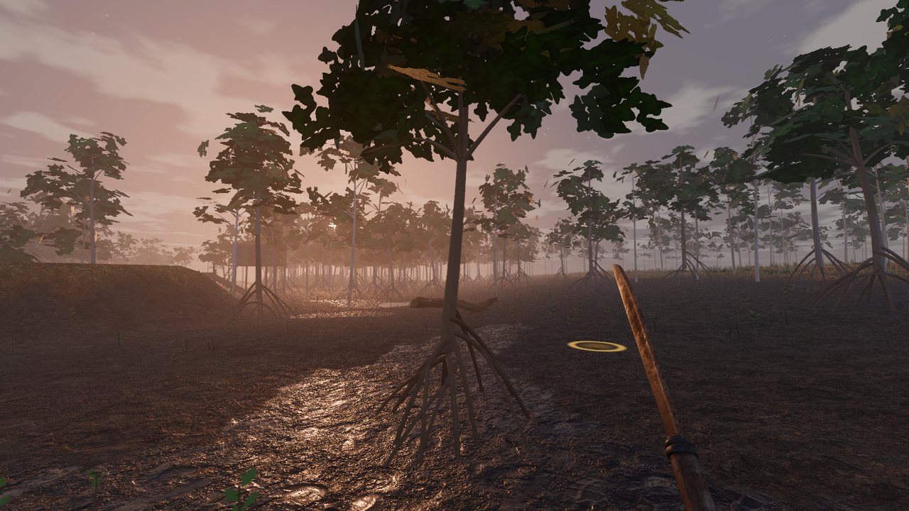
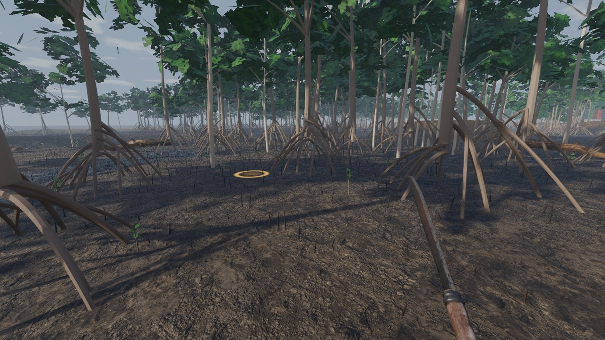
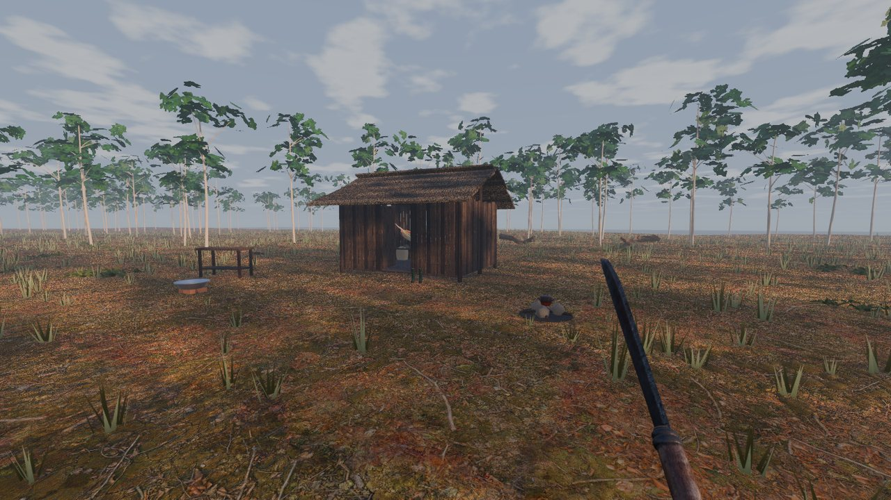
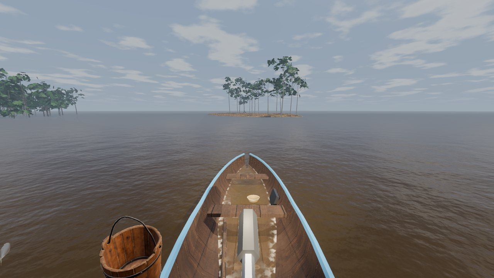
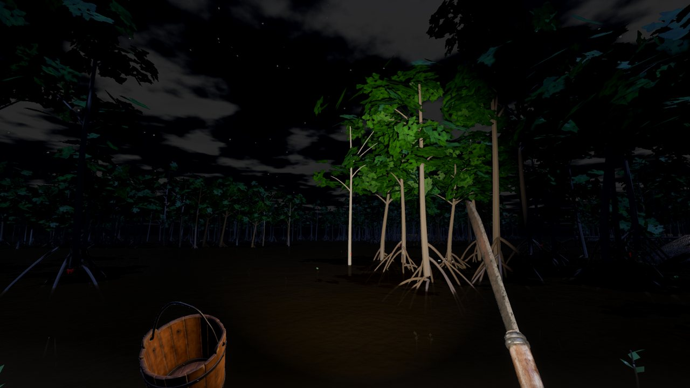
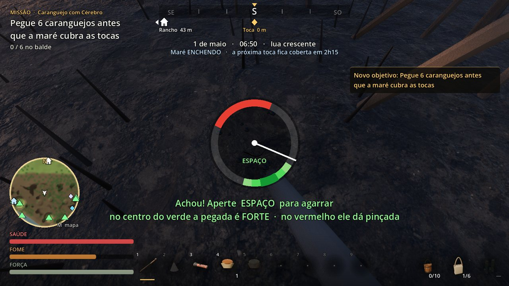
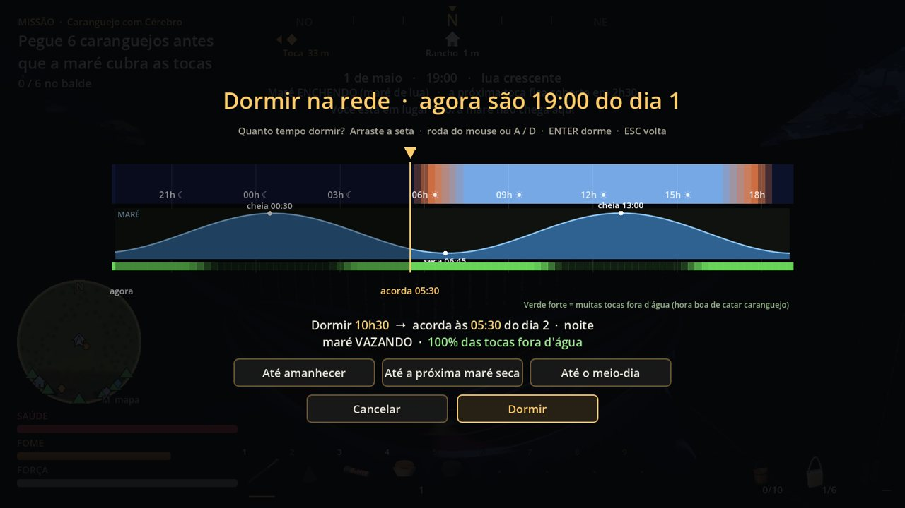
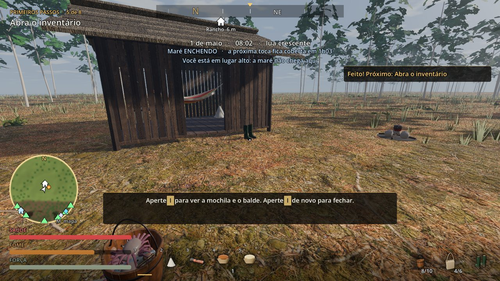

# MARÉ — sobrevivência no mangue



**Maré** é um jogo de sobrevivência em primeira pessoa num manguezal do Maranhão. A comida está na lama e o relógio é a maré: ela sobe e desce duas vezes por dia, cobre as tocas, alaga o caminho de volta e decide quando dá para sair de casa.

Você mora num rancho na beira do mangue. Para comer, tem que catar caranguejo na toca, jogar tarrafa no cardume, pegar peixe nas poças da vazante, juntar lenha e cozinhar antes que a água chegue no peito.

É um jogo **aberto** (código MIT, arte livre), feito em **português**, com **Godot 4.7** e **Blender**. Está em desenvolvimento e aceita ajuda.

> **Estado:** jogável do começo ao fim das duas primeiras missões. A arte, a luz e o som ainda estão sendo feitos. Veja [Para onde vai](#para-onde-vai).

---

## Como é

| | |
|---|---|
|  |  |
| Mangue de manhã: cada anel dourado é uma toca | O rancho, na terra firme, onde a maré não chega |
|  |  |
| A canoa consertada, atravessando a baía | À noite, o aratu sobe nas raízes |

| | | |
|---|---|---|
|  |  |  |
| Na toca: enfiar o braço, agarrar no verde, puxar e soltar na hora | Dormir escolhendo as horas: a faixa mostra a maré e as tocas de fora | Os primeiros passos ensinam uma coisa de cada vez |

## O que tem para fazer

- **Catar caranguejo-uçá na toca.** É um minijogo de braço, pegada e puxão. O caranguejo tem cérebro: foge para a toca, escapa pela toca vizinha, levanta a pinça e belisca. Fêmea e miúdo se soltam.
- **Ler a maré.** Ela sobe até 2 m, é maior na lua cheia e na nova (maré de lua) e cobre primeiro as tocas mais baixas. Na cheia, o mangue alaga e a lama prende a perna; é hora de voltar ao rancho ou subir num teso.
- **Pescar.** Tarrafa no cardume, peixe com a mão nas poças da vazante (cuidado com o esporão do bagre) e aratu nas raízes na maré cheia.
- **Cozinhar.** Fogão de 3 pedras no rancho, ou um jirau-fogão de pau, talo e lama montado em qualquer lugar do mangue. Com farinha d'água, a comida sustenta mais.
- **Sobreviver.** Fome, força e saúde. Lama mole que atola, arraia na água rasa, muriçoca no fim da tarde, chuva e temporal de janeiro a junho.
- **Missões.**
  - *Caranguejo com Cérebro*: o primeiro dia.
  - *Parabólica na Lama*: juntar as peças de uma canoa velha espalhadas pelo mangue, lavar o motor com água da chuva e atravessar a baía até a ilha.
- **Homenagens ao mangue beat:** a parabólica fincada na lama, a palafita, e nomes que misturam Maranhão e Pernambuco.

## Como jogar

Ainda não tem versão para baixar e jogar direto. Por enquanto, roda pelo Godot (é rápido):

1. Baixe o **[Godot 4.7](https://godotengine.org/download)** (a versão padrão, não a .NET). No Mac também dá com `brew install --cask godot`.
2. Baixe este repositório (**Code → Download ZIP**) ou clone:
   ```bash
   git clone https://github.com/igormaiamesquita/mare.git
   cd mare
   godot --path jogo
   ```
   Ou abra o Godot, importe a pasta `jogo/` e aperte **F5**.

### Teclas

| Tecla | O que faz |
|---|---|
| **W A S D** · **SHIFT** | andar · correr |
| **E** | usar, pegar, cortar lenha, entrar na toca |
| **ESPAÇO** | pular, soltar a perna da lama, subir em borda alta |
| **1 a 9** | atalhos: 1 facão · 2 tarrafa · 3 lanterna · 4 farofa · 5 farinha |
| **botão do mouse** (tarrafa na mão) ou **T** | segure para mirar, solte para jogar |
| **I** · **M** · **F** · **B** | inventário · mapa · lanterna · construir jirau-fogão |
| **ESC** | pausa, configurações, novo jogo |

A lista completa fica em *Configurações → Controles* e em [`jogo/LEIA-ME.md`](jogo/LEIA-ME.md).

## Para onde vai

| Fase | O quê | |
|---|---|---|
| 0 | Consertos do rancho, bacia, galochas, rede | ✅ |
| 1 | Configurações de imagem e controle, primeiros passos, menus | ✅ |
| — | Dormir escolhendo as horas, barra com ícones, inventário novo | ✅ |
| 2 | **Iluminação**: luz por hora do dia, sombra no mangue fechado, noite legível | em andamento |
| 3 | **Arte**: árvores de mangue de verdade, mão e braço, facão e animação, sons | |
| 4 | **A ilha**: praia, dunas, vila de pescadores, ilhotas e um final | |

Quer ajudar numa dessas? Veja abaixo.

## Como ajudar

Toda ajuda conta: **jogar e contar o que achou**, código, modelos 3D, texturas, **som** (o jogo ainda não tem nenhum), pesquisa sobre o mangue e quem vive dele.

- **Achou um problema ou tem uma ideia?** Abra uma [issue](https://github.com/igormaiamesquita/mare/issues/new/choose).
- **Quer pôr a mão no código ou na arte?** O passo a passo está em [`CONTRIBUINDO.md`](CONTRIBUINDO.md).
- **Só material livre:** arte de terceiros só com licença CC0 ou CC BY, com crédito.

## Como é feito

- **[Godot 4.7](https://godotengine.org)**, em GDScript. Quase tudo é montado por código em `jogo/scripts/main.gd`: terreno, maré, rancho, vegetação e itens.
- **[Blender](https://www.blender.org)**, por script: `blender/gerar_assets.py` modela e exporta os objetos do jogo, e `blender/importar_externos.py` ajusta os modelos livres do [Poly Haven](https://polyhaven.com).
- **Ícones** gerados fotografando os próprios modelos 3D (`godot --path jogo -- --icones`).
- **Teste automático**: um script joga as missões apertando as teclas de verdade e roda a cada *pull request*.

```
jogo/            projeto Godot (scripts, shaders, modelos .glb, texturas, ícones)
blender/         scripts que geram os modelos + modelos de terceiros (externos/)
docs/imagens/    imagens deste README
.claude/skills/  passo a passo para quem usa o Claude Code no projeto
```

## Licença

- **Código:** MIT ([`LICENSE`](LICENSE)).
- **Arte feita para o jogo:** CC BY 4.0.
- **Arte de terceiros:** CC0 (Poly Haven).

Detalhes em [`LICENCA-ARTE.md`](LICENCA-ARTE.md).

O jogo se inspira no modo de vida de quem vive do mangue, mas é uma obra original: não usa nome, imagem nem voz de pessoas reais.
